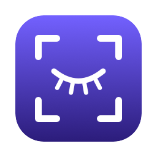

<p align="center">
  
</p>

<h1 align="center">Kirpik</h1>

<p align="center">
  A lightweight screenshot tool for macOS.<br>
  Native on Apple Silicon. Runs entirely on your Mac.
</p>

---

## Features

- **Quick area capture:** press ⌘⇧9, drag over any screen, then resize or move the selection
- **Annotations:** pen, line, arrow, rectangle, filled rectangle, ellipse, marker, text, pixelate and numbered steps
- **Copy or save:** to the clipboard or as a PNG file
- **Copy text (OCR):** grab the text inside the selection, recognized on-device
- **Copy color:** pick any pixel and copy its hex code
- **Magnifier:** pixel-accurate positioning while selecting
- **Menu bar app:** no Dock icon; the shortcut can be changed in Settings

## Requirements

- macOS 14 Sonoma or later
- Xcode or the Command Line Tools (`xcode-select --install`) to build

## Installation

```bash
git clone https://github.com/ferenozcelik/kirpik.git
cd kirpik
./build.sh --install
```

This builds the app, copies it to `/Applications` and launches it. You can also double-click `Install.command`.

On the first capture, macOS asks for **Screen Recording** permission. Turn on Kirpik in
*System Settings → Privacy & Security → Screen & System Audio Recording*, then reopen the app.

> The app is ad-hoc signed, so macOS asks for the permission again after each rebuild.

## Usage

Press **⌘⇧9** and drag to select an area. Hover a toolbar button to see what it does.

| Key | Action |
| --- | --- |
| ⌘C or ↩ | Copy and close |
| ⌘S | Save as PNG |
| ⌘Z / ⇧⌘Z | Undo / redo |
| Scroll | Change line and text size |
| ⇧ while drawing | 45° lines, squares and circles |
| esc | Close |

## Privacy

Kirpik has no network access. Screenshots, OCR and settings never leave your Mac.

## License

Released under the [MIT License](LICENSE).
